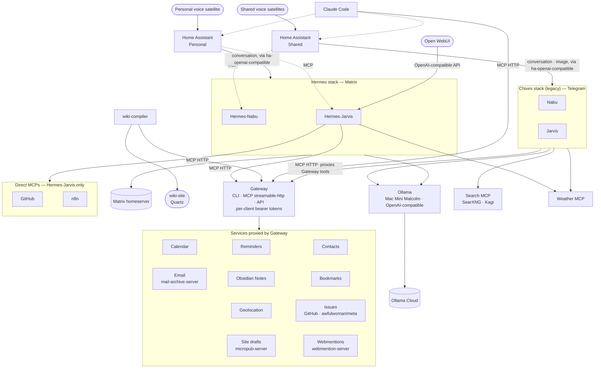

# Personal Cloud

A high-level, aspirational overview of my personal cloud - the self-hosted personal automation ecosystem I'm steering towards.

Last reviewed: 2026-10-25.

## Overview

## Systems

### Gateway

Presents a proxy interface for many other services, in the form of CLI, MCP, and API.

The MCP interface is served over streamable-http (`http://host:4000/mcp`). Clients register with `claude mcp add --transport http`, rather than the old SSE endpoint or hand-edited config.

Each caller has its own bearer token on `/mcp` (Claude Code, the laptop, `gw` CLI, Hermes, Chives-Jarvis, wiki-compiler). The token's label names the caller in a per-request usage log. Per-client authorisation (different tool sets for different callers) is not built yet. [Authentik](#authentik) now runs on storage, but Gateway does not use it.

- Calendar (real Apple Calendar via [apple-calendar-server](https://github.com/awfulwoman/apple-calendar-server) — replaced Google Calendar)
- Reminders (real Apple Reminders via [apple-reminders-server](https://github.com/awfulwoman/apple-reminders-server) — replaced Radicale)
- Contacts (real macOS Contacts via [apple-contacts-server](https://github.com/awfulwoman/apple-contacts-server) — replaced Radicale)
- Email (multi-account IMAP sync + search via [mail-archive-server](https://github.com/awfulwoman/mail-archive-server))
- Obsidian notes
- Bookmarks (Karakeep)
- Issues (GitHub issues in a single repo, default `awfulwoman/meta`, via the GitHub REST API)
- Geolocation (OwnTracks)
- Site drafts (draft posts on awfulwoman.com via [micropub-server](https://github.com/awfulwoman/micropub-server); publishing and deleting stay in its web UI)
- Webmentions (review what other sites have sent, and send for a post, via [webmention-server](https://github.com/awfulwoman/webmention-server); rejecting and sending only: approving stays with the owner, since a stranger's text reaches the agent, and it never trusts, blocks or deletes)

The three Apple-backed services run natively on Malcolm (the always-on Mac), since EventKit and the Contacts framework are macOS-only and need a logged-in GUI session for the permission grant. Everything else runs in the Gateway container itself.

Mastodon, Photos, Weather, and Search were on this list in an earlier draft of this document but were never built into Gateway — Weather and Search instead ended up as their own standalone MCP servers (see below), and the rest remain unbuilt. (The personal site did arrive later, as draft posts and Webmentions above.)

### Ollama

Runs on a Mac Mini (Malcolm) where it can, if needed, use local LLM models. Practically it's connected to Ollama Cloud. Presents an OpenAI-compatible interface.

Used by both agent stacks below.

### Ollama Cloud

Allows access to cloud-based models via Ollama.

### Chives stack (Nabu · Jarvis) — legacy

**Superseded by the Hermes stack below.** It still runs, but no new work goes into it. When it is retired, remove the `nabu`/`jarvis` compositions and the `jarvis` Gateway token. Then the `hermes-` prefix (see below) is no longer needed.

The original agent stack: [Chives](https://github.com/awfulwoman/chives), a local-first Python agent talking to Ollama and reaching Gateway's tools by proxying them over MCP HTTP. Runs as two Telegram bots, `nabu` and `jarvis`, deployed on `server-64gb-storage`. Each is its own container with its own Telegram token, memory, and scheduled nudges.

Also has the Home Assistant MCP, the SearXNG search MCP and the weather MCP wired in.

### Hermes stack (Hermes-Nabu · Hermes-Jarvis)

The current agent stack: [Hermes Agent](https://github.com/NousResearch/hermes-agent), a self-hosted agent from Nous Research, run as one container per identity (`hermes-nabu`, `hermes-jarvis`) on `minipc-8gb-agatha`. Talks to the same Ollama endpoint on Malcolm. Chat happens over Matrix rather than Telegram (each bot has its own account on the self-hosted homeserver on `server-64gb-storage`), and each container exposes its own OpenAI-compatible API (port 8642) so other systems — Home Assistant, Open WebUI — can drive it directly.

The two identities have very different tool access:

- **Hermes-Nabu** (house agent) — only the Home Assistant MCP.
- **Hermes-Jarvis** (general assistant) — the Gateway MCP (full tool set), the Home Assistant MCP, a weather MCP, GitHub's hosted MCP server (via a dedicated helperbot account, for forking public repos and opening PRs/issues), and the MCP of the self-hosted [n8n](#n8n) instance.

An earlier single multi-profile `hermes-agent` container ran both identities as Hermes "profiles," but profiles share one process environment — all of them ended up authenticating to Matrix as the same account (an acknowledged upstream bug). Splitting into one container per identity fixed that.

`hermes-nabu`/`hermes-jarvis`, rather than plain `nabu`/`jarvis`, because the Chives stack already owns those composition names and subdomains — the two stacks are unrelated but collide on naming, both having been built around the same `nabu`/`jarvis` Home Assistant wake words.

### Standalone MCP servers

All on `server-64gb-storage`, outside Gateway:

- **Search** — `mcp-searxng` (self-hosted SearXNG) and `mcp-kagisearch` (Kagi).
- **Weather** — `mcp-weather`.
- **OpenZIM** — `openzim-mcp`, offline reference content (Wikipedia and similar) from the same ZIM library that Kiwix serves.

### n8n

Workflow automation on `server-64gb-storage`. Hermes-Jarvis and Claude Code reach it through its instance MCP to build and run workflows.

### Matrix

Self-hosted homeserver on `server-64gb-storage`. The chat surface for the Hermes stack.

### Open WebUI

A chat frontend, deployed alongside the Hermes stack on `minipc-8gb-agatha` specifically so it can reach Hermes-Jarvis's API server by container name on the shared Docker network.

### Home Assistant - Shared

The interface to our home. Provides automations, dashboards, and connections to various physical hardware, such as Zigbee networks, Thread networks, and various home devices.

Uses the [`ha-openai-compatible`](https://github.com/awfulwoman/ha-openai-compatible) custom integration (a fork of HA's core OpenAI integration with a configurable base URL) to point its conversation agent at an agent stack's OpenAI-compatible endpoint, and separately connects to Hermes-Nabu over MCP.

### Home Assistant - Personal

A separate Home Assistant instance that connects to a single voice satellite.

Same `ha-openai-compatible` wiring as above, pointed at the personal-agent identity, plus a direct MCP connection to Hermes-Jarvis.

### Claude Code

Agent harness from Anthropic.

Connects to Gateway and Home Assistant. Sessions run on `minipc-8gb-camina` by default, with Malcolm as a break-glass fallback.

### Wiki: wiki-compiler and wiki-site

[wiki-compiler](https://github.com/awfulwoman/wiki-compiler) compiles the Obsidian vault and Gateway's data (calendar, bookmarks, contacts, reminders, location) into an Obsidian-compatible wiki that an LLM maintains, with a citation on every fact. It reads Gateway through its own token. wiki-site serves the result as a static [Quartz](https://quartz.jzhao.xyz) site behind basic auth. wiki-compiler is the only writer. Both run on `server-64gb-storage`.

### translation-server

[translation-server](https://github.com/awfulwoman/translation-server) translates documents (mostly German → English) with translategemma on Malcolm's Ollama. It has a DeepL v2-compatible API and a LAN web UI. A second container takes Paperless-ngx workflow webhooks and adds a linked English companion to each document. Internal only, on `server-64gb-storage`.

### Authentik

SSO on `server-64gb-storage`. Each OIDC app is defined as a blueprint from infra. Immich uses it now. More apps are to follow, possibly Gateway.

### Personal site: micropub-server and webmention-server

Two small services sit around the static site (Hugo, [awfulwoman.com](https://awfulwoman.com)), both on the public VPS:

- **micropub-server** takes posts from any Micropub client and commits them to the site's repo, then shares them to Mastodon (GoToSocial) and Bluesky. It is also the IndieAuth server the other service signs in through.
- **webmention-server** receives Webmentions (replies, likes and reposts from other sites) and sends them for the site's own posts. Nothing shows on the site until it is approved. The site's pages fetch approved mentions in the browser, so they cost the build nothing. It tells Home Assistant when something needs review.

Both are reachable from Gateway (above) for drafting and reviewing from a chat.

### Ops

Not in the diagram. Each ZFS host runs [zfs-api](https://github.com/awfulwoman/zfs-api) (read-only pool, snapshot and backup status, with Prometheus metrics). VictoriaMetrics scrapes it. Gatus does health checks, and Loki and Logtide collect logs. Alerts go to Home Assistant, not email.

## Hosts

| Host | Role in this map |
| --- | --- |
| `server-64gb-storage` | Most services: Gateway, mail-archive-server, Matrix, n8n, Authentik, standalone MCPs, wiki-compiler/wiki-site, translation-server, Chives stack, Karakeep, Paperless-ngx |
| `apple-macmini-m4-16gb-malcolm` | Ollama, apple-calendar/contacts/reminders-server (native macOS); break-glass Claude Code host |
| `minipc-8gb-agatha` | Hermes stack, Open WebUI |
| `minipc-8gb-camina` | Default Claude Code host; Syncthing (Obsidian vaults), basic-memory, Wiki.js |
| `vps-hetzner-public01` | micropub-server, webmention-server |

## Notes

Jarvis and Nabu (and Hermes-Jarvis and Hermes-Nabu) are only used because they are hardcoded as wake words in the Home Assistant voice satellites. That is why two unrelated agent stacks have the same two names.

## Emerging

- **webmention-server phase 5** — specced, not built. A poller that collects replies and likes from GoToSocial for syndicated posts (backfeed), so Bridgy is only needed for Bluesky.
